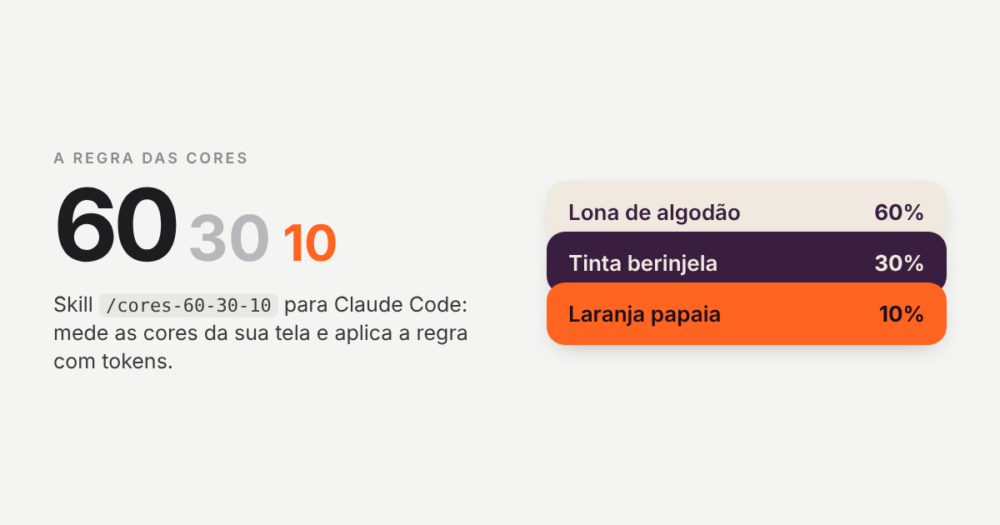

# 60-30-10 color rule

**A Claude Code skill that organizes your app's colors with the 60-30-10 rule, plus two tools that measure whether a screen follows it.**

[🇧🇷 Português](README.md) | 🇺🇸 English



60% of the area in a main color, 30% in a secondary one, 10% in an accent. The background rests, the blocks give structure and the accent points at what matters because it is rare.

## Easiest way

```text
Read https://github.com/guilhermeforprojeto/regra-60-30-10 and follow AGENTS.md. Apply the 60-30-10 rule to this project. Reply in English.
```

## Install

`npx skills add guilhermeforprojeto/regra-60-30-10`, or clone and run `bash instalar.sh` / `instalar.ps1`. Then `/cores-60-30-10` in Claude Code.

## Tools (Python 3 + Pillow)

- `python ferramentas/medir_cores.py screenshot.png`: area share of each color and a reading of the rule; warns when the accent exceeds 20% or the strongest color became the background.
- `python ferramentas/contraste.py "#FF6420" "#1B0E1D"`: WCAG contrast.

Demo: [`demo/index.html`](demo/index.html). Idea and palettes: [@falandocomdaniel](https://www.tiktok.com/@falandocomdaniel). Files are in Portuguese; AI agents follow them in any language. License: [CC BY 4.0](LICENSE).
