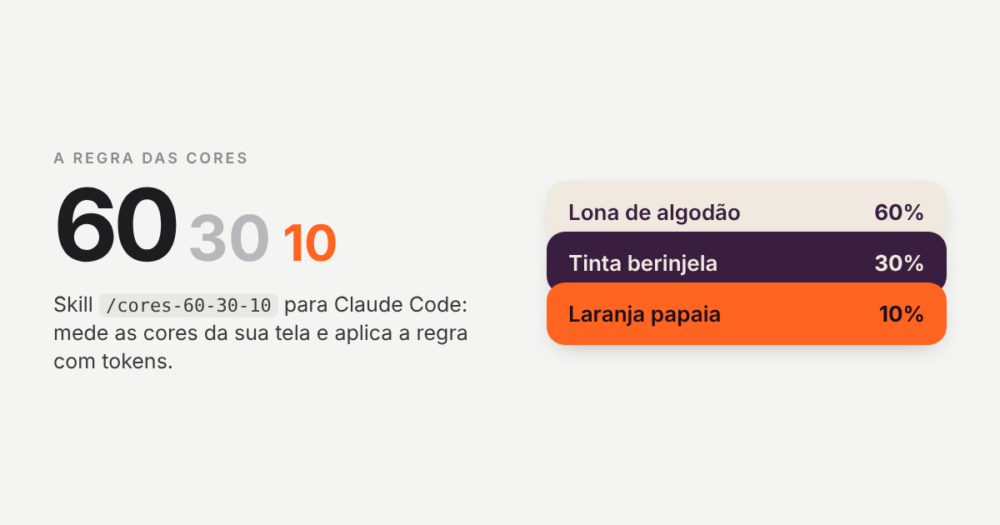
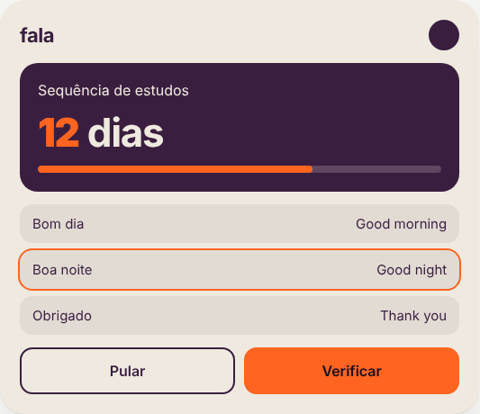
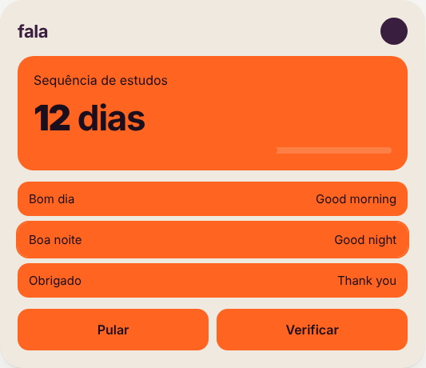

# Regra 60-30-10

**Uma skill para o Claude Code que organiza as cores do seu app pela regra 60-30-10, e duas ferramentas que medem se a tela segue a regra.**

🇧🇷 Português | [🇺🇸 English](README.en.md)



60% da área numa cor principal, 30% numa secundária e 10% num destaque. É a regra que faz um app parecer pensado em vez de colorido: o fundo descansa, os blocos dão estrutura e o destaque aponta para o que importa, porque é raro. Trocar só o destaque (laranja → fúcsia → verde) muda a cara do produto inteiro.

| Com a regra | Sem a regra |
| --- | --- |
|  |  |
| 63% · 26% · 7%, medido pela ferramenta | 60% de laranja: o destaque virou fundo |

---

## Jeito mais fácil: mande o link para a IA

Abra o Claude Code (ou Cursor, Codex) no seu projeto e cole:

```text
Leia https://github.com/guilhermeforprojeto/regra-60-30-10 e siga o AGENTS.md. Organize as cores deste projeto pela regra 60-30-10.
```

## Instalar a skill

```bash
npx skills add guilhermeforprojeto/regra-60-30-10
```

Ou clone e rode `bash instalar.sh` (macOS/Linux) ou `powershell -ExecutionPolicy Bypass -File instalar.ps1` (Windows). Depois, no Claude Code: `/cores-60-30-10`.

## Ferramentas

Precisam de Python 3 e `pip install pillow`.

**Medir um print:**

```bash
python ferramentas/medir_cores.py print.png
```

```
  Área  Cor       Saturação
 63.0%  #EEE8DE  0.07  ███████████████████████████████
 25.8%  #391D3E  0.53  █████████████
  6.6%  #FE6320  0.87  ███

Principal  ~63%  #EEE8DE
Secundária ~26%  #391D3E
Destaque   ~7%  #FE6320
```

Avisa quando o destaque passa de 20% da tela ou quando a cor mais forte virou fundo.

**Contraste WCAG:**

```bash
python ferramentas/contraste.py "#FF6420" "#1B0E1D"
# Contraste 6.30:1 — texto normal (AA 4.5): passa
```

## O que a skill faz

1. Mede as cores atuais (prints e tokens do código).
2. Define os três papéis. Se já há marca, ela costuma virar o destaque.
3. Cria tokens com nome de papel (`--cor-principal`, `--cor-secundaria`, `--cor-destaque`).
4. Aplica: fundo na principal, cards e barras na secundária, destaque só na ação principal, no item ativo, no progresso e num dado-chave.
5. Confere contraste, proporção, teste do borrão e modo escuro.
6. Entrega uma tabela do antes e depois.

## Demo

Abra [`demo/index.html`](demo/index.html): três paletas, uma tela de app e a opção "sem a regra" para ver o destaque espalhado.

| App | Principal 60% | Secundária 30% | Destaque 10% |
| --- | --- | --- | --- |
| fala | Lona de algodão `#EFE9DF` | Tinta berinjela `#3A1E3F` | Laranja papaia `#FF6420` |
| passo | Musgo negro `#1F231F` | Aveia com leite `#D8C6A6` | Fúcsia faísca `#FF2D8F` |
| onda | Creme mármore `#EEE6D8` | Marrom ganache `#3B251D` | Verde kelly `#1FC858` |

Os nomes e a maioria dos valores vêm do vídeo de referência; lona de algodão, musgo negro e creme mármore são aproximados.

## Créditos

Ideia e paletas do vídeo de [@falandocomdaniel](https://www.tiktok.com/@falandocomdaniel) ("A regra das cores"). Skill, ferramentas e demo escritas do zero.

## Licença

[CC BY 4.0](LICENSE). Se te ajudou, deixa uma ⭐.
